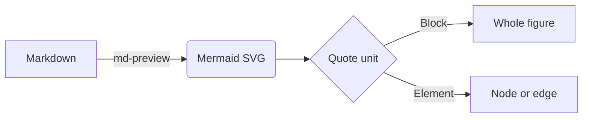

# Markdown preview: every feature

Each block below is one thing the md-preview renders. Click a block to quote it; select some words and press 📎 Quote selection.

## Headings

### Level 3
#### Level 4
##### Level 5
###### Level 6

## Inline

Plain text with **bold**, *italic*, `inline code`, and a [link](https://example.com) (links open in a new tab and do not quote).
Lines that follow each other join into one paragraph,
like this one.

Japanese and emoji wrap too: 日本語の段落も一つの塊として引用できます 🧪

## Lists

- Bullet one
- Bullet two with **bold**
* Star bullet
+ Plus bullet
  continued on an indented line

1. First
2. Second
3. Third with `code`

## Quote

> A block quote.
> Two lines become one quote block.

## Code fence

```python
def hello(name):
    return f"<b>{name}</b> & friends"   # HTML is escaped, not rendered
```

## Mermaid



## Table

| Feature | Rendered | Note |
|:--|:--:|--:|
| Headings | ✅ | h1–h6 |
| **Bold** in a cell | ✅ | inline works in cells |
| `code` | ✅ | |
| Mermaid | ✅ | flowchart, sequence, etc. |

## Escaping

<script>alert("this must show as text")</script> and 1 < 2 & 3 > 2.

## Not covered (shown as plain text on purpose)

Images like , ~~strike~~, footnotes[^1], and nested lists are outside the small renderer.

[^1]: A footnote line.
